# 价格行为学 · 反转的原理与五个基本步骤

> 自动生成讲课课件 · 来源 B站 video.mp4（源视频 12.3 分钟） · **本课件口播约 23.1 分钟** · 画面 17 张（16 张原讲义图 + 1 张自制图）

## 目录（期 / 段 / 关键画面）

| 期次 | 主题 | 段 | 关键画面 |
| --- | --- | --- | --- |
| 第1期 | 第1期 · 反转的五个基本步骤 | 开场与价格行为学课程体系；第一步：趋势遇阻，出现回调；第二步：二次或三次测试原极点；第三步：突破趋势线（含实盘画线示范）；第四步：突破主要高点或主要低点；第五步：高点上移/低点下移确认新趋势；五步流程整体回顾；重要提醒：反转未必形成新趋势 | 8 段 |
| 第2期 | 第2期 · 案例一二：双顶反转与空头力量确认 | 案例一引入：上涨被下跌反转；识别遇阻：大阳线的长下影线；产生极点与二次测试；更大结构：深度回调 + 二次测试 = 双顶；空头确认：跌破主要低点并低点下移；案例一趋势线视角：首次即破线的双顶反转 | 6 段 |
| 第3期 | 第3期 · 案例三四：进入交易区间与三推反转 | 案例三引入：反转未必产生新趋势；弱趋势通道中的预阻与假突破；破线破高点却无高点上移，进入交易区间；案例四引入：急速接通道的上涨趋势；识别三推结构；三推后破线并低点下移，形成新空头趋势 | 6 段 |
| 第4期 | 第4期 · 复盘总结与反转的成功率 | 五步总流程复盘；突破主要高低点的意义与反转确认；反转概率低：80%的反转尝试会失败；复盘作业与本节结语 | 4 段 |

---

# 第1期 · 反转的五个基本步骤

## 开场与价格行为学课程体系

【语气明快，开场直接抛结论】

大家好，欢迎回到我的频道，我是洪毅。——

今天这节课，我先给大家一个听起来有点反常识的结论：**你看到一根大阴线，不代表反转来了；事实上，大约 80% 的反转尝试，最后都会失败。**——

【放慢，加重】

为什么？因为真正的反转，从来不是一根 K 线说了算的，它需要**按顺序走完五个步骤**，少一步，都不算数。今天这节课，我们就把这五个步骤一个一个拆开讲清楚。——

先简单回顾一下我们的课程计划。之前我定过一个计划，是把价格行为学的几大块系统讲完：第一个是**趋势**，第二个是**交易区间**，第三个是**反转**，第四个是**交易管理**。——

【指图】

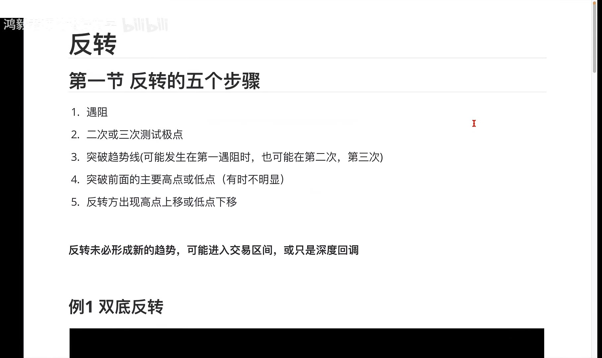

前面两块，趋势和交易区间，我们都已经讲完了。那么从今天这节开始，我们正式进入第三块——**反转**。——

你可以这样理解这四块内容的关系：趋势，是告诉你「车在往哪开」；交易区间，是告诉你「车在原地打转」；反转，是告诉你「车要掉头了」；交易管理，是告诉你「掉头的时候手该怎么放」。——今天我们专注在「掉头」这件事上。

（约 1.5 分钟，语速约 240 字/分钟）

---

## 第一步：趋势遇阻，出现回调

【语气平稳，进入正题】

好，首先，对于反转，我们需要知道：反转它是有这么几个步骤的。**第一个，就是趋势首先是要遇到阻力。**——

什么叫**遇阻**？就是原来的趋势走不动了，开始出现反方向的力量。比如说，一段**多头趋势**——多头趋势指的就是价格一路往上走、高点不断抬高的行情——那么它需要出现什么？比如说出现**阴线**了，对不对？出现**回调**了。——

【加重】

这里要解释一下**回调**。回调，指的是趋势行进过程中，出现的一段反方向的小幅运动，但并不改变原有趋势的方向。就像你爬山，往上爬十步、往下退两步，退的这两步就是回调。——

那么多头趋势里出现阴线、出现回调，这就说明什么？说明上升的动能受阻了。这就是第一步，好。——

【贯穿类比，放慢】

**打个比方**，整个反转过程就像一辆高速行驶的车要掉头。第一步绝对不是猛打方向盘，而是**先踩刹车、先减速**。遇阻，就是这脚刹车。你看不到刹车灯亮，就别谈掉头。——

【检验提问，停顿 1 秒】

所以请你先想一秒：在你最近看的图上，价格创新高的时候，那一根 K 线有没有留下**影线**、后面有没有跟着阴线？——如果一根都没有，那它连刹车都没踩，离掉头还远得很。

（约 2.2 分钟，语速约 240 字/分钟）

---

## 第二步：二次或三次测试原极点

【语气递进】

好，这是它的第一步。然后呢，遇到阻力之后一般出现回调，**回调之后，趋势会第二次、甚至第三次去测试原来的这个极点。**——

这里出现一个关键名词，叫**极点**。极点就是一段趋势走到的最远的那个点——多头趋势里就是最高点，空头趋势里就是最低点。你可以说它就是这波行情的「天花板」或者「地板」。——

【指图】

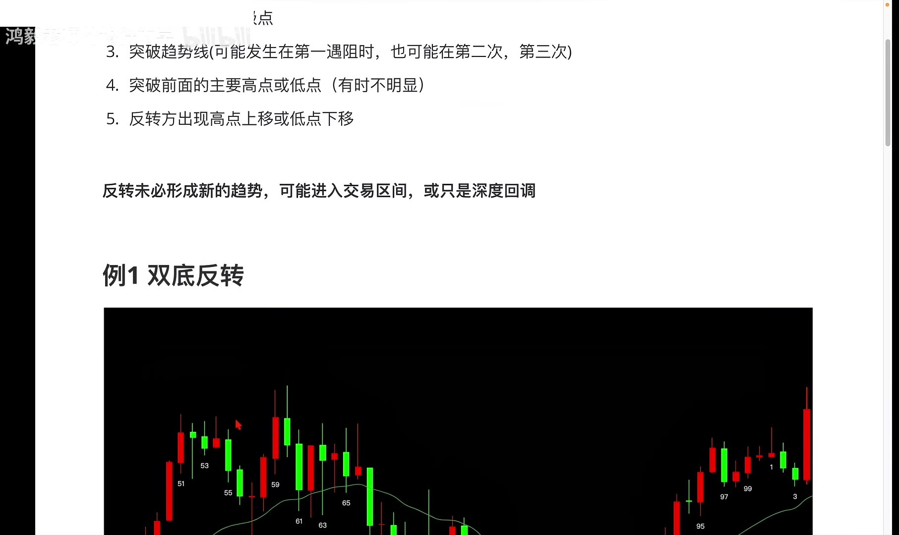

那么回调之后，价格会回来再碰一次这个天花板。对这个极点的测试，可能有三种结果：**可能达不到这个极点，可能刚好碰到这个极点，也可能刚好超过这个极点**，形成一个——注意这个词——**假突破**。假突破就是价格短暂越过了关键位置，但站不住，很快又退回来，就像一只手伸出门缝又缩了回去。——

【贯穿类比】

**你可以这样理解**：天花板被撞了一下，掉下来一块灰——这就是第一步的遇阻；然后人会不甘心，再跳起来第二次、第三次去顶这块天花板。跳起来的这几次，就是**二次测试、三次测试**。重点不是它顶不顶得到，而是「有人在反复尝试」这件事本身。——

【检验提问，停顿 1 秒】

考你一秒：价格第二次冲上来，差一点点没碰到前高就掉头——这算测试吗？——算。而且「差一点没到」，往往比「刚好碰到」更能说明买方力量在衰减。

总之，它会第二次或者第三次去测试原来的这个极点。这是第二步。

（约 1.8 分钟，语速约 240 字/分钟）

---

## 第三步：突破趋势线（含实盘画线示范）

【语气加重，进入重点】

然后呢，测试完之后，**它会突破趋势线。**——

先把术语说清楚：**趋势线**，就是沿着一段趋势的波动低点（上升趋势）或者高点（下降趋势）画出来的一条斜线，它相当于这段趋势的「跑道边线」。价格一直在边线内跑，说明趋势还在；一旦跑到边线外面去，说明这条跑道可能要作废了。——

那么对趋势线的突破，有可能**在第一次回调它就突破了，也可能第二次才突破**。我们在这里来画一条趋势线。——

【动手画线，动作放慢】

比如我们从这里开始，往下画一条趋势线，连住这波上涨的几个低点。好，你看——

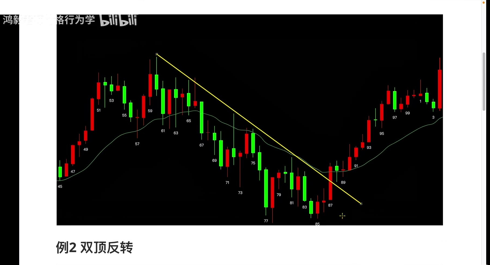

市场在这里**遇阻**了，有一个深度回调，然后二次去测试前面那个极点，然后——注意——**在第二次的时候，突破了这个趋势线**，对吧？——

【语气坚定】

它**一定是要突破趋势线的**。这是硬性条件，没有例外。——

有些时候第一次回调就会突破趋势线。比如说在**左边**，左边这个比较陡峭的、这段多头趋势里面，你可以看到，**第一次回调的时候它其实就突破了趋势线**，然后有一个二次测试，对吧？二次测试，然后有一个通道下来。所以第一次的时候就突破了趋势线。——

不管是第一次突破还是第二次突破，那么它**一定会发生一个突破趋势线的动作**。——

【贯穿类比，检验提问，停顿 1 秒】

还是拿掉头的车打比方：前面两步是刹车、是减速试探，这第三步，才是**车头真正压过中线**的那一下。——所以我想让你停一秒想一想：你现在手上的持仓，价格有没有压过这条边线？如果一次都没有压出去过，那它只是开得慢了，不是要掉头。

（约 4.2 分钟，语速约 240 字/分钟）

---

## 第四步：突破主要高点或主要低点

【语气推进】

然后**第四步**呢，就是：它要**突破前面的一个主要高点，或者主要低点。**——

什么叫**主要高点、主要低点**？指的是一段结构中，那些明显的、有支撑或压力作用的转折点。简单说，就是多头趋势里最近那个「小山峰」的山顶，或者空头趋势里最近那个「小山谷」的谷底。——

【语气放缓，提示难点】

有些时候主要高点和主要低点**不是**很明显，需要你自己去判断。但是在我们这个例子里面它是比较明显的。比如说，好——

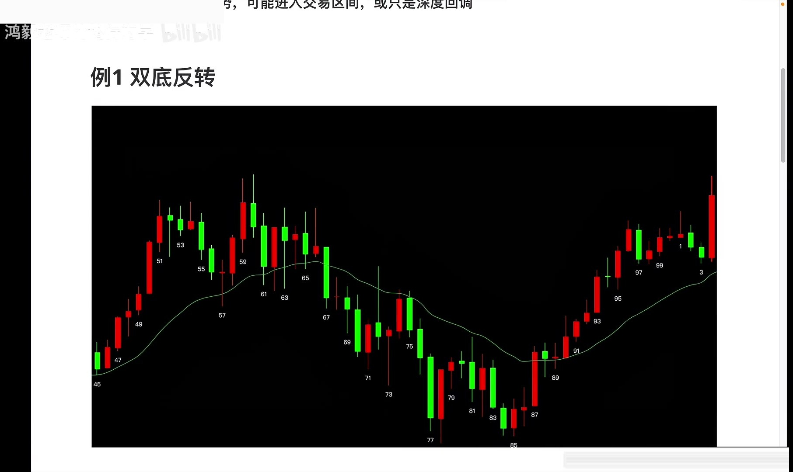

比如说呢，我们还是一样的，我们画一条趋势线下来，然后这里呢，是它遇阻了嘛，遇阻出现回调，对不对？然后二次测试，二次测试。好，上来，上来——这个点，是不是它的主要的一个高点？——

下跌，回调，下跌，回调，下跌，对不对？它这个高点主要在降低嘛。**这是一个主要高点**，然后这个主要高点最终会被突破。——

【放慢，纠正式口吻】

（顺带说明一下，这里我刚才差点口误说成主要低点，其实是**主要高点**，因为它是在上方被突破的那个位置。你看图的时候也一样，先问自己一句：我标出来的这个点，是高点还是低点？别看反了。）——

【贯穿类比，检验提问，停顿 1 秒】

**你可以理解为**：压过中线只是车头过去了，而突破主要高点，是**整个车身都过了中线**，对面的车已经必须让你了。——所以停一秒问自己：在你的图上，那个被突破的点，是前一个明显的山峰顶，还是你随手点的一个位置？

这一步的意义在于，突破了主要高点或者主要低点，就说明**原来的趋势已经不成立了**。

（约 3.2 分钟，语速约 240 字/分钟）

---

## 第五步：高点上移/低点下移确认新趋势

【语气转向收束】

最后一个特征是什么？最后一个特征是：**反转方向上，会出现高点上移，或者低点下移。**——

两个词解释一下：**高点上移**，指的是后面的高点比前面的高点更高；**低点下移**，指的是后面的低点比前面的低点更低。前者说明买方在主导，后者说明卖方在主导。——

好，就说我们还是来看这个例子。

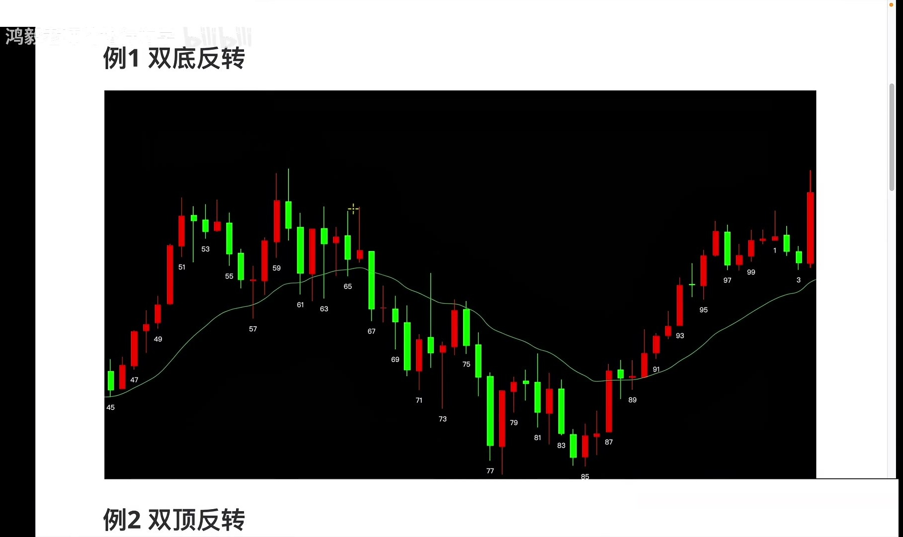

在这个例子里面，然后，好，这边是原来的趋势，这是反转的这个趋势。它会出现一个——高点的一个上移，对吧？这是低点的一个上移，就会出现这么一个动作。——这样，就会**确定一个多头趋势的形成**。好，这个就是反转的五个步骤。——

【贯穿类比，放慢】

**好比**掉头的车已经完全调过来了，并且开始沿反方向加速、还创出了新里程——这才叫掉头成功。如果只是停在路中间不动，那不叫掉头，那叫抛锚。**高点上移，就是那脚新方向的油门。**——

【检验提问，停顿 1 秒】

停一秒：反转方向上，如果只是突破了前高，但下一个高点没超过它，这算不算新趋势成立？——不算。第五步没走完，反转就没有被确认。

（约 2.3 分钟，语速约 240 字/分钟）

---

## 五步流程整体回顾

【语气系统化，逐条数】

好，我们再整体回顾一下。

**第一个**，就是它要遇阻，遇阻就是它开始出现回调；**回调之后**，它会产生一个低点，或者产生一个高点；**然后**，需要二次或者三次去测试原来这个极点；**然后**，在第一次回调的时候，或者说是第二次回调的时候，它会突破趋势线；**然后**，会进一步地突破前面的主要高点，或主要低点；**同时**，反转的这个方向这个趋势，它会出现一个**高点上移**或**低点下移**的动作。——那就是说，一个新的趋势建立。——

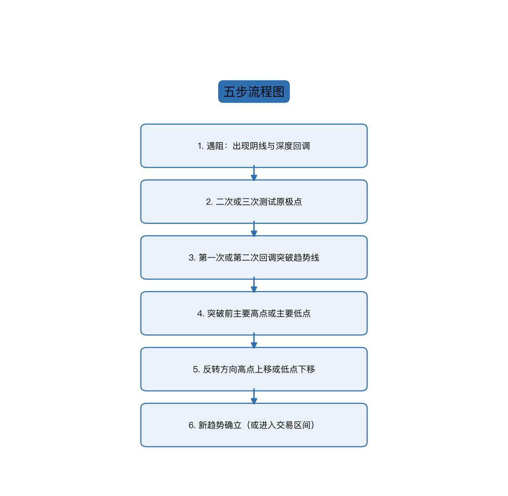

【指图，逐条指过去】

我们对着这张流程图再走一遍：第一步，**遇阻**，出现阴线与深度回调；第二步，**二次或三次测试原极点**；第三步，**第一次或第二次回调突破趋势线**；第四步，**突破前面的主要高点或主要低点**；第五步，**反转方向出现高点上移或低点下移**；最后，**新趋势确立**——当然，也有可能是进入交易区间。——

那么这个是常见的趋势反转的几个步骤。**几乎所有反转，大概都遵循这几个步骤。**——

【贯穿类比，检验提问，停顿 1 秒】

**你可以这样理解**：这五步就像一道有先后顺序的关卡，**顺序不能打乱、也不能跳关**。——停一秒问自己：如果我看到价格只走到「突破趋势线」这一步就急着做反转单，我跳过了哪两关？答案是第四和第五关，也就是最容易被打脸的两关。

（约 3.8 分钟，语速约 240 字/分钟）

---

## 重要提醒：反转未必形成新趋势

【语气转为提醒，放慢】

然后我们需要注意一点的是：**反转，它未必形成新的趋势。**——它有可能进入到**交易区间**，或者，它只是对前面趋势的一个**更深度的回调**。好。——

【加重】

这句话请记住：走完五步，只说明「原来的趋势不成立了」，不等于「新的反方向趋势成立了」。就像车掉头之后，它可能开走，也可能停在路边，甚至可能绕一圈又开回原路。这一点，是我们后面所有案例的核心主题，一定要带着这个意识去看图。

（约 1.2 分钟，语速约 240 字/分钟）

---

# 第2期 · 案例一二：双顶反转与空头力量确认

## 案例一引入：上涨被下跌反转

【切案例，节奏加快】

那我们来看一下，刚才我们这个例子已经看过了，我们再看第二个例子。第二个例子，那么**左边是一段上涨的趋势，然后被这边一段下跌的趋势给反转了**。我们来看一下，这个过程是怎么发生的。——

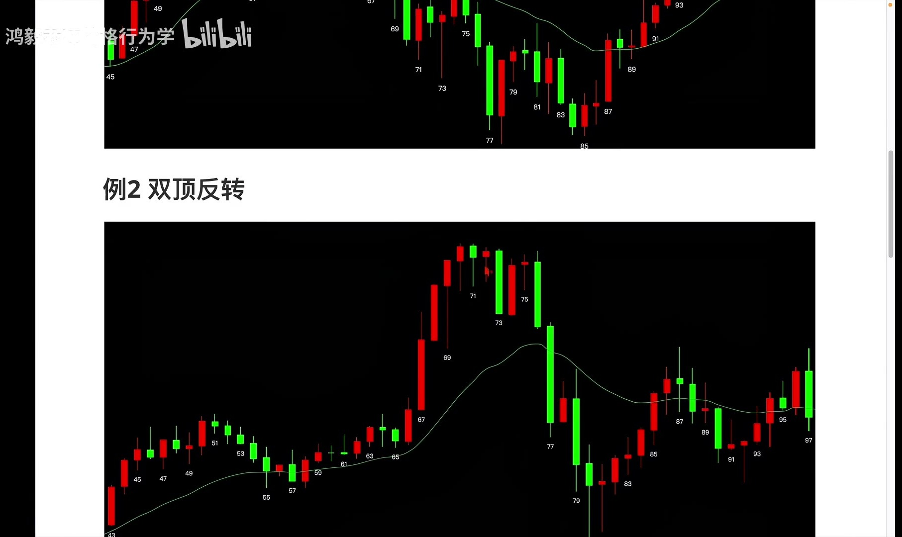

首先的话，好，这个上涨趋势——

（约 1.4 分钟，语速约 240 字/分钟）

---

## 识别遇阻：大阳线的长下影线

【逐根 K 线分析，指图】

几根——**三根连续的阳线**，对吧？很强很强的阳线。好，看起来这个趋势是很强的。但是你可以看到**这一根大阳线**，它发生了什么事情呢？——

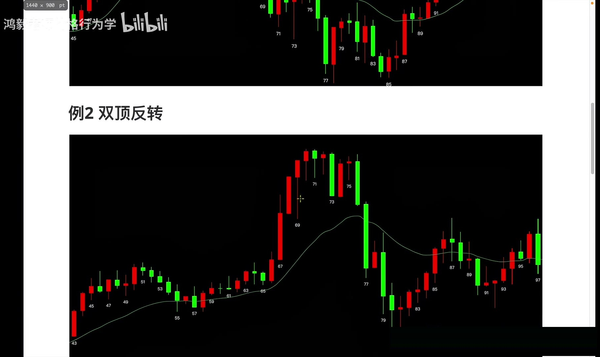

有一个**很长的下影线**。下影线说明什么？下影线说明，说明它是不是有——有一个回调啊？这个回调，幅度还不浅，幅度还挺深的。——

【加重】

所以这就是一个典型的**遇阻**。就是这根 69 号 K 线是遇阻了。——

这里解释一下：**下影线**，就是 K 线实体下方那根细线，它记录的是这根 K 线盘中曾经跌下去、又被拉回来的那段距离。**长下影线**，就是盘中曾经跌得很深，说明空方在这里实实在在打进去过一拳。——

【贯穿类比】

**打个比方**：三根强阳线就像一个人全力冲刺，看着势不可挡；但那根长下影线，是他冲刺中途被绊了一下、膝盖都弯下去了才重新站起来。**人还在往前跑，但力道已经漏出来了。**——

（约 2.4 分钟，语速约 240 字/分钟）

---

## 产生极点与二次测试

【指图，逐步推】

预阻之后，好，然后这个地方它其实就开始产生了一个**极点**，产生一个极点。当然，你也可以认为说——你也可以认为说，**这根阴线是第一次预阻**。好，然后这个地方是极点。然后，好，**回调之后，第二次去测试这个极点**，这是——这是极点嘛，对不对？这是第二次去测试极点。好，然后呢，开始下跌。——

【贯穿类比，检验提问，停顿 1 秒】

**你可以理解为**：那根长下影线是有人在天花板上敲了一记，接下来价格回落后又蹦起来第二次去顶这块天花板。——停一秒：这次顶到之后，价格是怎么离开的？是慢慢滑下来，还是一根大阴线砸下来？离开的方式，决定你下一步该看什么。

（约 1.9 分钟，语速约 240 字/分钟）

---

## 更大结构：深度回调 + 二次测试 = 双顶

【切换视角，放大结构】

好，当然，这个从更大的一个结构来看，它其实是这样子的：其实是**上涨之后，好，这是一次深度回调，然后呢，好，二次测试，然后产生一个双顶。**——好，这个看起来会更清晰一点。——

两个词说明一下：**深度回调**，指的是回调的幅度很深、甚至接近或超过前一段涨幅一半以上的回调，它已经不只是喘口气，而是方向感出了问题；**双顶**，就是价格两次冲到差不多同一个高度、两次都没能站上去，图形上像两个并排的山头。——

【加重，关键结论】

就说**我们要看到空头的力量表现出来才可以**。就是前面我们前面的这两种分析，比如把这个地方当成一个——当成一个深度回调的第一次预阻，然后把这个地方当成一个极点测试。但是你会发现，**如果我们这样看的话，你没有看到空头的力量表现出来**。——

那什么时候看到空头的力量表现出来呢？就是说，**这个大阴线出来了**。这个大阴线出来，空头的力量表现出来之后，我们再去考虑它有可能发生反转。那么前面的话，你就**只能把它当成回调来看**。——

【贯穿类比，检验提问，停顿 1 秒】

**好比**你看一个人说要辞职：嘴上说说，那叫回调；直到他真的把工牌交出来——那根大阴线就是交工牌的动作——你才承认他要走了。——停一秒：在你的图上，有没有那根「交工牌」级别的大阴线？没有，就别把它当反转。

（约 2.7 分钟，语速约 240 字/分钟）

---

## 空头确认：跌破主要低点并低点下移

【顺着流程推到底】

好，那现在呢，就是**上涨遇阻**，好，然后**二次测试**，然后**下跌**，对吧？——

这个你可以把它当成前面的一个**主要的一个低点**，这个主要的点被跌破了。然后这地方呢，出现一个**低点的一个下移**，对吧？空头的低点的一个下移。好。——

【节奏收束】

所以这个案例的完整顺序是：三根强阳线 → 长下影线遇阻 → 产生极点 → 二次测试 → 大阴线确认空头力量 → 跌破主要低点 → 低点下移。一步都没跳。——

【贯穿类比】

**就像**掉头的车：刹车（长下影线）→ 试探性回打方向（二次测试）→ 压过中线（大阴线破趋势线）→ 车身过线（跌破主要低点）→ 沿反方向开出新低（低点下移）。**每一步都有对应的画面，不是感觉。**

（约 1.9 分钟，语速约 240 字/分钟）

---

## 案例一趋势线视角：首次即破线的双顶反转

【换一个角度再看同一段行情】

还有一件就是，我们来看一下这个例子里面的**趋势线**的部分。你可以从这个地方来画一条趋势线，对吧？——

画出趋势线之后呢，其实，那么这根 K 线啊，**这根 73 号 K 线，大阴线，它实际上跌破了趋势线，就是首次就跌破了趋势线。**然后呢，二次去测试前面的这个极点。好。然后呢，再**跌破前面的这个主要的低点**，然后再出现一个**低点的下移**。——

那么这个就是一个**双顶反转**的一个过程，跟前面是一样的。——

【对比式总结，检验提问，停顿 1 秒】

请注意对比：第一期那个例子是**第二次回调才破线**，这里是**第一次就破线**。破线的时机可以不同，但「一定要破线」这件事不能省。——停一秒问自己：我以前是不是把「破线」当成了可选项？

（约 2.6 分钟，语速约 240 字/分钟）

---

# 第3期 · 案例三四：进入交易区间与三推反转

## 案例三引入：反转未必产生新趋势

【语气转折，抛出新问题】

然后我们来看第三个例子。**那么，反转不一定会产生新的趋势，有可能进入到交易区间。**——

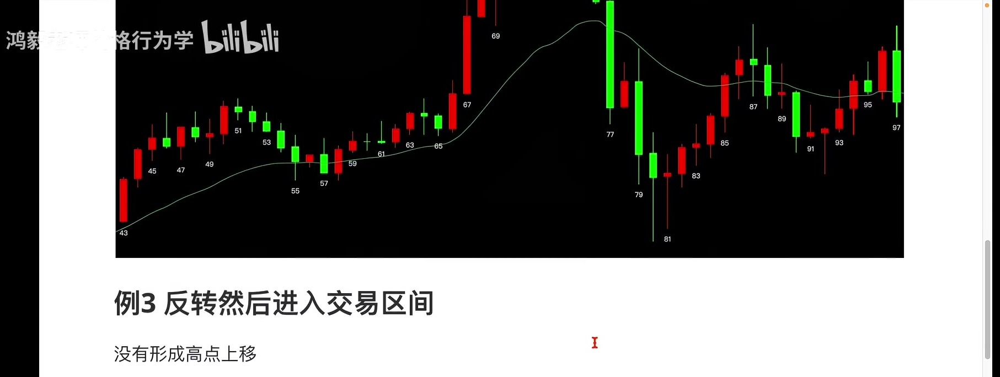

进入交易区间，就是说——就是说，它在反转之后，**并没有出现高点上移、低点下移**，它有可能进入的一个交易区间。来，看一下这个例子。——

【贯穿类比】

**打个比方**：前面两个案例是车真的掉头开走了；这第三个案例，是车调了个头，却停在马路中间不动了。**方向变了，但没有「走」起来**，这就是交易区间。

（约 1.4 分钟，语速约 240 字/分钟）

---

## 弱趋势通道中的预阻与假突破

【指图，逐点讲】

好，这个例子，同样的，我们来看一下，这边是有一个**通道**。——

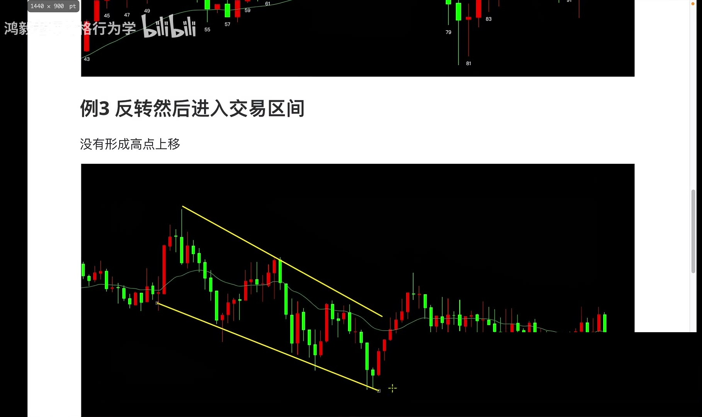

**通道**，指的是一段趋势中，价格沿着一条斜线反复来回走、看起来像一条倾斜的走廊，它也是趋势的一种，只是说这个趋势它可能不是这么强，是一个**弱趋势**。——

弱趋势之后，然后我们可以看到，这里实际上出现了**第一次的一个预阻**，对不对？预阻。然后**测试极点**，测试极点，对不对？这个地方是极点，这个地方是极点。然后**二次测试**，当然稍微突破一点，但是一个**假突破**，对吧？——

假突破之后呢，然后呢，好，向上去深度回调。——

【贯穿类比，检验提问，停顿 1 秒】

**你可以这样理解**：弱趋势就像一条有点坡度的传送带，货还是在往上走，但走得慢、还老往下滑。二次测试略微冲过极点又掉下来，就好比货被推到边缘、晃了一下又滑回带子上——**这个「晃出去又回来」的动作，就是假突破**。——停一秒：假突破出现时，你是急着追，还是等它回来？

（约 2.4 分钟，语速约 240 字/分钟）

---

## 破线破高点却无高点上移，进入交易区间

【重点对比，放慢】

这个时候，第二次的时候它干嘛了？是不是**突破了趋势线**？对。突破趋势线，并且**突破了前面这个主要的高点**啊，这个高点。但是呢——

【语气停顿，加重】

但是你会发现，它**没有形成**——没有形成这个**高点的一个上移**，没有这样走。所以它随后呢，它是**进入到了一个交易区间里面了**。看到没有？对不对？进入到一个交易区间里面了。——

那么这是第三个例子，就是**反转之后进入到交易区间**。好。——

【贯穿类比，检验提问，停顿 1 秒】

**好比**掉头的车过了中线、也开过了对面车道的入口，但下一脚油门没踩下去，于是它就在路口来回晃。**第三步、第四步都做完了，唯独第五步缺席。**——停一秒：如果我在第四步就重仓进场，第五步又没来，我会怎样？答案是被来回打脸。

（约 1.9 分钟，语速约 240 字/分钟）

---

## 案例四引入：急速接通道的上涨趋势

【切最后一个案例】

好，我们来看最后一个例子。我们刚才所讲的例子都是，预阻，然后有极点测试极点。那么我们来看一下这个例子，这个例子它是**三推之后，然后突破趋势线，然后出现低点下移。**——

来看一下左边，这一段上涨趋势。然后这个上涨趋势的话我们可以看到，这个地方是一个**急速**，急速然后接一个**通道**，对吧？——

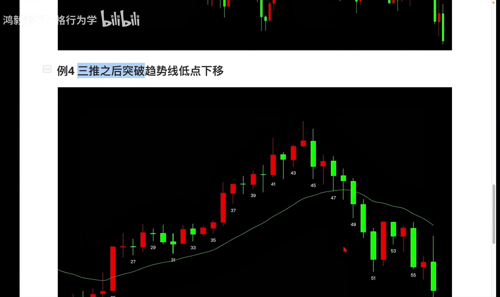

两个词说明：**急速**，指的是一段又快又陡、K 线一根接一根往上冲的走势，说明买方力量集中爆发；**急速接通道**，就是先猛冲一段，然后速度慢下来、沿着一条斜线往上爬。——

急速接通道的话，我们从通道线这里——就是沿着那个 K 线的高点的话，画一条线，就是**通道线**。通道线我们会发现，这里实际上有**三个点**：一、二、三。——

（约 2.3 分钟，语速约 240 字/分钟）

---

## 识别三推结构

【数触点，节奏明快】

那么这个就是**三推**。就是**第一次推动**，然后**第二次推动**，**回调**，**第三次推动**，第三次推动。这是一个三次推动。——

【贯穿类比】

**就像**推一辆装满东西的购物车上坡：第一下推得动，第二下还行，第三下你使出全力，它也只是往前挪了一点点。**三次推动，一次比一次费劲，这本身就是动能衰竭的信号。**——三推，指的就是价格沿同一个方向连续三次冲击、每一次都更吃力的形态。

（约 1.4 分钟，语速约 240 字/分钟）

---

## 三推后破线并低点下移，形成新空头趋势

【收束案例】

三次推动的话，那么随后，**第三次推动之后突破了趋势线**，突破了趋势线，对吧？然后形成一个——形成一个**低点的一个下移**，对吧？不只是下移，**形成一个新的空头趋势**。那么这个是一个三推，然后这是一个急速接通道之后的一个反转一个形态。——

【贯穿类比，检验提问，停顿 1 秒】

还是那辆上坡的购物车：推三下推不动，它开始往下滑，滑过那条坡道边线（破趋势线），然后越滑越低（低点下移）——**这就不是减速了，这是彻底掉头往回走。**——停一秒：如果只看到「第三次推不动」就做空，跳过了破线那一步，风险在哪里？在于它还可能第四次推上去。

（约 1.8 分钟，语速约 240 字/分钟）

---

# 第4期 · 复盘总结与反转的成功率

## 五步总流程复盘

【回到全局，系统复盘】

那么我们举了这四个例子，大家应该可以看到，就是**大部分的反转，基本上都遵循这么几个步骤**。——

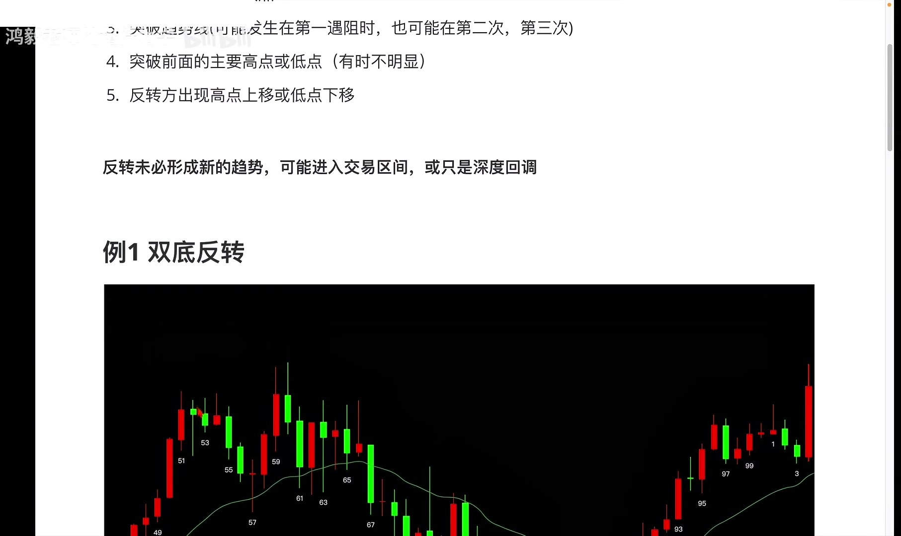

**首先**，它是预阻，就是会出现深度回调；然后**产生一个低点，或产生一个高点**；然后呢，它会**二次或三次去测试**前面的这个高点或低点，前面那个极点；然后，**在第一次回调，或者第二次回调的时候，它会去突破趋势线**。——

好，那突破趋势线之后呢，**进一步地去突破前面的这个主要的高点、主要的低点**。比如说这里是突破这个低点，对吧？这里呢是要突破这个高点，高点。然后突破之后，那就说明**以前的趋势已经不成立了**，对吧？——

【贯穿类比，放慢】

**你可以理解为**：这四段行情是四个不同的司机，开的是不同的车，但掉头的动作流程一模一样。**价格行为学研究的不是某一辆车，而是「掉头」这件事本身的规律。**

（约 3.4 分钟，语速约 240 字/分钟）

---

## 突破主要高低点的意义与反转确认

【强调判定标准】

那么，**反转方**，如果说出现了**高点抬升**，对不对？或者**低点下移**，那就说明对前面的趋势，是不是形成了逆转？一个新的趋势产生了。——

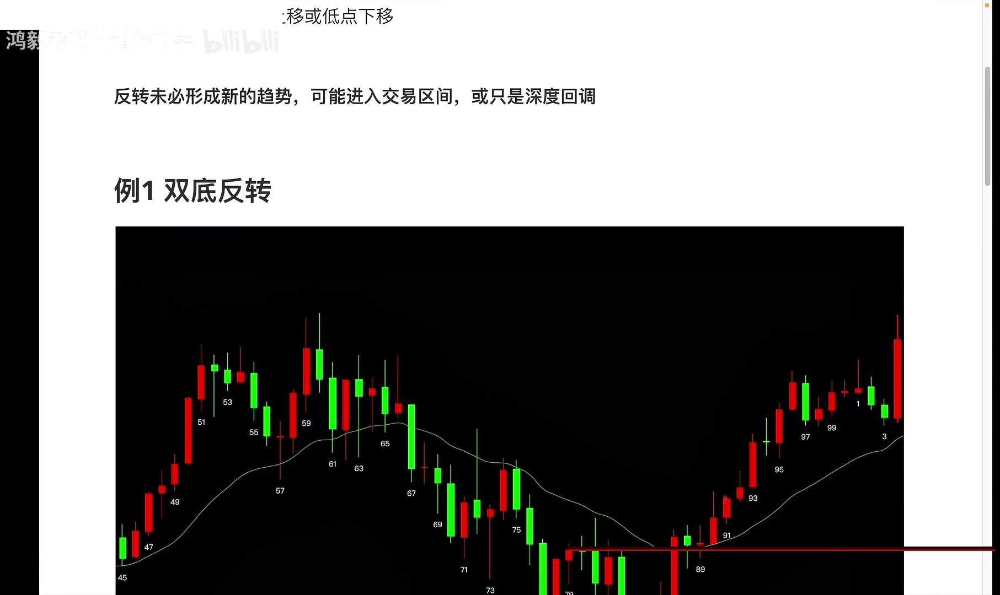

这里给你一个可以直接套用的判定顺序：**突破主要高低点 = 原趋势作废；高点上移或低点下移 = 新趋势成立。**——前一句管「旧的」，后一句管「新的」，两句都要有，才算数。——

当然，如果说它没有出现这种高点抬升的一个动作的，比如说像我们取的第三个例子，那么它就进入到一个交易区间。——

【检验提问，停顿 1 秒】

停一秒：现在给你一段行情，它破了趋势线、也破了前高，你能在图上指出「高点抬升」那个点吗？指不出来，就别喊反转。

（约 1.7 分钟，语速约 240 字/分钟）

---

## 反转概率低：80%的反转尝试会失败

【语气放慢，抛核心结论】

那么，**反转的概率是比较低的。80% 的反转尝试会失败。**——大部分时候呢，市场它实际上会进入到一个**交易区间**或者**深度回调**，而不是会产生一个新的趋势。——

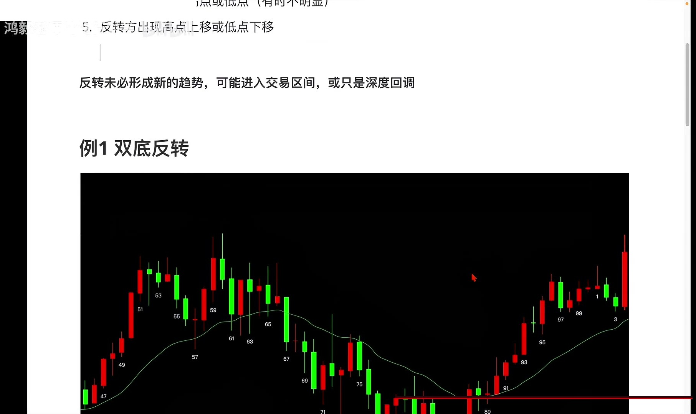

【加重，展开解释】

为什么这个数字重要？因为它改变了你的默认动作。**默认动作不是「看到反转就做」，而是「看到反转迹象，先等五步走完」。**——

【贯穿类比】

**好比**路口掉头的车，十辆里有八辆最后是停在路中间或者绕回去了。你要是每看到一辆打转向灯的车就抢行，一定会出事。**等它真的开到反向车道，你再动。**——

这就是为什么我们要把五个步骤拆这么细：不是为了事后解释，而是为了让你在第四步、第五步没出现之前，管住自己的手。

（约 1.6 分钟，语速约 240 字/分钟）

---

## 复盘作业与本节结语

【收尾，布置动作】

好，那么大家可以对着图表，可以把这几个点呢，去复盘一下，看一下是不是这样发生的。——

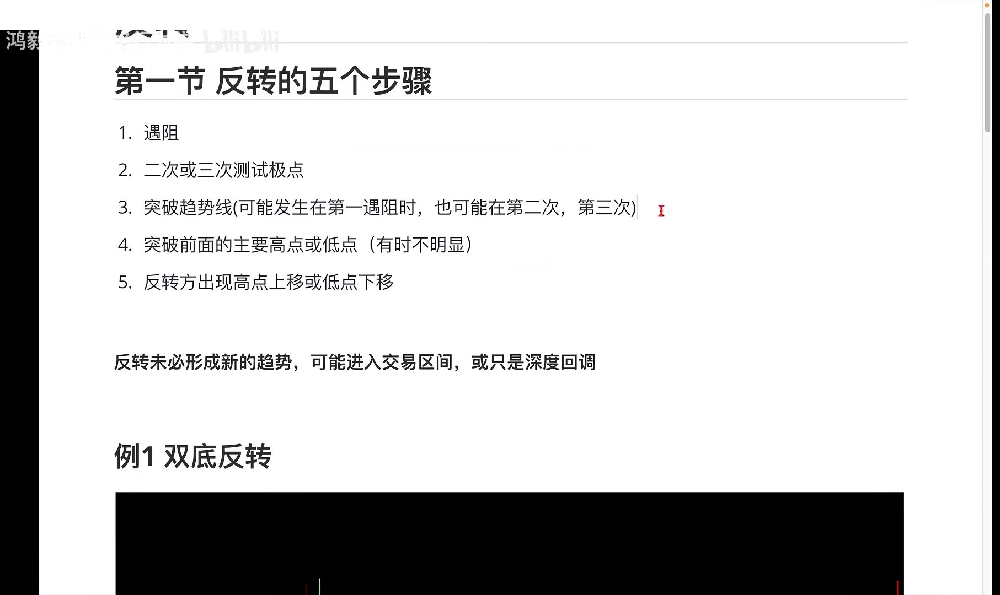

好，那么这是反转的一个原理，或者反转的几个基本步骤，**这是我们的第一节**，那就讲到这里。谢谢大家。——

【放慢，补一句方法论】

最后多说一句：这五个步骤是**地图**，不是**命令**。地图告诉你现在走到了哪一站，但要不要下车、下多少仓位，是后面「交易管理」那一块要讲的事。先别急，把地图认熟。

（约 1.5 分钟，语速约 240 字/分钟）

---

## 【课后可执行动作清单】

- 【动作】打开 TradingView 或你的行情软件，找出最近一段**已经走完的反转行情**，按「遇阻回调 → 二次/三次测试极点 → 突破趋势线 → 突破主要高/低点 → 高点上移或低点下移」五步，用 1、2、3、4、5 在图上逐个标注。
  **完成判定**：五个数字全部标出，且顺序不颠倒；若某一步找不到，记下是第几步。

- 【动作】在你当前关注的品种上，画出**一条趋势线**和**一个主要高点/主要低点**，观察价格现在停在流程的第几步。
  **完成判定**：图上同时存在趋势线与主要高低点两条标注，并写下「当前处于第 X 步」。

- 【动作】用今天的「长下影线 = 预阻」判据，翻出 3 根带**长下影线或长上影线**的大阳线/大阴线，看它后面是否出现过二次测试。
  **完成判定**：至少找到 3 例，并对每例写下「有 / 没有二次测试」。

- 【动作】把案例三（破线破高点却无高点上移、最终进交易区间）与案例一（双顶 + 低点下移）并排画成两张小图，对比第五步有没有出现。
  **完成判定**：两张图都画完，并在案例三图上用红笔圈出「高点上移缺席」的位置。

- 【动作】在自己最近的一笔持仓上，标出「高点上移 / 低点下移」的实际位置，判断这笔持仓是踩在新趋势里，还是停在交易区间里。
  **完成判定**：图上标出至少两个连续的高点或低点，并写出结论句「本持仓属于：新趋势 / 交易区间 / 深度回调」。

---

## 附一 · 画面清单

| 文件 | 时刻 | 用途 |
| --- | --- | --- |
| frames_clean/V001.jpg | 00:12 | 回顾课程计划：价格行为学四大块——趋势、交易区间、反转、交易管理；趋势与交易区间 |
| frames_clean/V002.jpg | 00:36 | 反转的第一步是趋势遇到阻力，表现为多头趋势中出现阴线、出现回调，说明上升动能受阻 |
| frames_clean/V003.jpg | 01:02 | 回调产生低点/高点后，趋势会第二次甚至第三次去测试原来的极点；测试结果可能是达不 |
| frames_clean/V004.jpg | 01:40 | 反转必须发生突破趋势线的动作，可能第一次回调就突破，也可能第二次才突破；现场画趋 |
| frames_clean/V005.jpg | 02:35 | 突破趋势线后，还要进一步突破前面的主要高点或主要低点；主要高低点有时不明显，本例 |
| frames_clean/V006.jpg | 03:15 | 反转方向上出现高点上移或低点下移，说明新的多头（或空头）趋势结构成立，反转完成。 |
| frames_clean/V007.jpg | 03:50 | 把反转五个步骤串起来复述一遍：遇阻回调→二次/三次测试极点→突破趋势线→突破主要 |
| frames_clean/V008.jpg | 04:40 | 第二例左边是一段上涨趋势，被右边的下跌趋势所反转，逐步拆解整个反转过程。 |
| frames_clean/V009.jpg | 05:05 | 三根连续强阳线显示趋势很强，但某根大阳线带很长下影线，说明盘中出现幅度不浅的回调 |
| frames_clean/V010.jpg | 07:50 | 反转过程若不出现高点上移/低点下移，就可能进入交易区间而非新趋势，用第三例说明。 |
| frames_clean/V011.jpg | 08:20 | 通道也是一种趋势但属于弱趋势；通道内出现第一次预阻，随后测试极点，二次测试时略微 |
| frames_clean/V012.jpg | 09:25 | 本例是三推后突破趋势线、低点下移的反转：左侧上涨为急速+通道结构，沿K线高点画出 |
| frames_clean/V013.jpg | 10:55 | 四个案例共同遵循的步骤：预阻与深度回调→产生低点/高点→二次或三次测试极点→第一 |
| frames_clean/V014.jpg | 11:30 | 突破主要高点/低点说明原趋势已不成立；若反转方向出现高点上移或低点下移，才说明对 |
| frames_clean/V015.jpg | 11:50 | 若未出现高点上移/低点下移（如第三例），则进入交易区间，反转概率较低；约80%的 |
| frames_clean/V016.jpg | 12:10 | 布置作业：对照图表复盘验证这五步是否成立；本节讲完反转的原理与基本步骤，是反转系 |
| diagrams/D001.jpg | 自制 | 五步流程图 |

---

## 附二 · 对原视频的核查纠正

**1. 自相矛盾**
- 原表述：走完五步，只说明「原来的趋势不成立了」，不等于「新的反方向趋势成立了」
- 纠正：第五步「反转方向出现高点上移或低点下移」本身就是新趋势成立的确认条件，走完五步即代表新趋势已建立；真正不等于新趋势成立的，是只走到第四步（突破主要高/低点）时——此时原趋势失效，但结果可能是交易区间或深度回调
- 依据：讲稿自身前后表述冲突：第五步原文为『出现高点上移……这样就会确定一个多头趋势的形成』，而案例三（进入交易区间）正是因为『没有形成高点上移』即第五步缺席

**2. 自相矛盾**
- 原表述：反转方向上，如果只是突破了前高，但下一个高点没超过它，这算不算新趋势成立？——不算。第五步没走完
- 纠正：应改为：『突破前高之后，回调的低点没有抬高、随后的高点也没能再创新高（即形成双顶或横盘），这算不算新趋势成立？——不算。』因为『突破前高』本身即已构成高点上移
- 依据：讲稿对『高点上移』的定义是『后面的高点比前面的高点更高』，突破前高恰好满足该定义，与问答结论冲突

**3. 错别字**
- 原表述：所以这就是一个典型的预阻。就是这根 69 号 K 线是预阻了
- 纠正：应统一为『遇阻』（遇到阻力），全稿多处混用『预阻/遇阻』，如『第一次的一个预阻』『长下影线 = 预阻』
- 依据：转写原话为『这就是遇到阻力』『预阻就是它开始出现回调』，语义为趋势遇到阻力（resistance），非『预先阻止』

**4. 事实错误**
- 原表述：深度回调，指的是回调的幅度很深、甚至接近或超过前一段涨幅一半以上的回调
- 纠正：深度回调应表述为『回调幅度明显大于普通回调，通常吃掉前一段趋势的 60%~100%，甚至跌破趋势线、回到前一次回调的起点附近』，不应以『超过一半』作为唯一硬标准
- 依据：『一半』（50%）是斐波那契回撤的一般回调位，并非深度回调的定义阈值；价格行为学中深度回调以其破坏趋势结构（如跌破趋势线、回到前低/前高）为判据

**5. 缺条件前缀**
- 原表述：用今天的「长下影线 = 预阻」判据，翻出 3 根带长下影线或长上影线的大阳线/大阴线，看它后面是否出现过二次测试
- 纠正：应加条件：『在一段明显趋势的末端、尤其是连续强趋势K线之后出现的长下影线（上升趋势中）或长上影线（下降趋势中）』才可视为遇阻信号，且需结合后续二次测试确认
- 依据：长影线在任意位置出现只是单根K线的日内波动，不能单独等同于『遇阻』；原视频的语境是强阳线后的大阳线长下影线，且强调『要看到空头力量表现出来才可以』考虑反转

---

## 附三 · 录制执行清单（给自己看，不念）

| # | 检查 | 勾 |
| --- | --- | --- |
| 1 | 盲讲 3 分钟做过了吗（关稿子、只看标题+关键词） | □ |
| 2 | 盲讲卡住的点列出来了吗 | □ |
| 3 | 画面满屏：编辑器侧栏已关，图片单独全屏预览 | □ |
| 4 | 每张图最小字号 ≥ 18pt | □ |
| 5 | 有没有即兴发挥的高风险句（必然/永远/充分必要） | □ |
| 6 | 出现的数字条件前缀写全了吗 | □ |

---

## 附四 · 成稿自检

- action_instructions: 3
- check_questions: 28
- analogy_marks: 4
- body_cn_chars: 5548
- body_duration_sec: 1387.0
- body_duration_min: 23.1